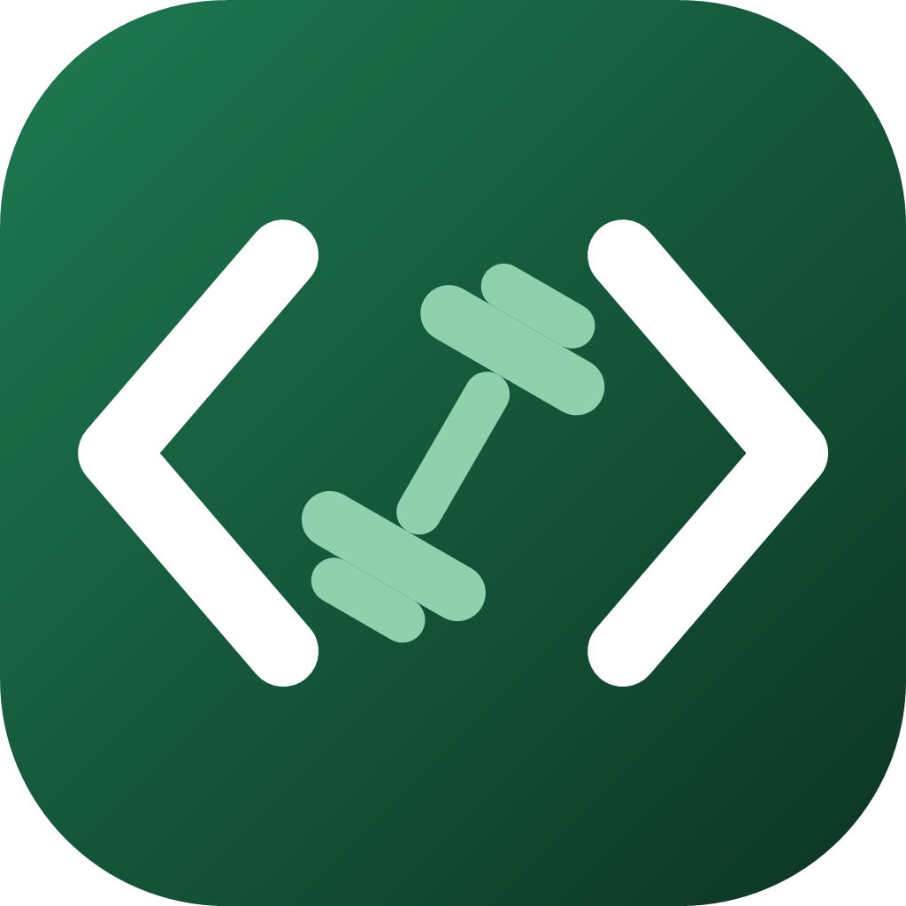

# DevGym

One Claude Code plugin with a small local service and web app.

- **Clarify** finds the places where a ticket can be read in more than one way and each reading leads to different code, asks only those questions, and saves what was answered and what was assumed.
- **Track** records each decision made while coding, with who made it and a pointer to the code.
- **Explain** asks the developer why a few of those decisions were made, and saves the answers with a rating.
- **Grow** shows the developer's level per area on a backend or frontend ladder (junior, mid, senior, staff), built from their own commits and answers, and a personal plan with exercises on real spots in their code. A skill is Proven only after an interview-style drill. How it decides: [docs/grow-levels.md](docs/grow-levels.md).

Developer profiles live in a SQLite file on the developer's machine and never leave it. Only the PR's "Decisions" section is shared with the team.

## Status

| Part | State |
| --- | --- |
| Backend: BE-1 to BE-13 | Built and tested |
| Web app: FE-1 to FE-8 | Built, reads the REST API, ships inside the plugin (`packages/plugin/web/`) |
| Eval: EV-1, EV-3, EV-5 | Answer key, scorer (`pnpm eval`) and privacy red team built |
| Eval: EV-2, EV-4, EV-6 | Not done: hand-marked decisions, senior review, the recorded video |

The full demo, step by step: [docs/demo.md](docs/demo.md).

`docs/week-1-status.md` and `docs/frontend-status.md` describe earlier states. Where they disagree with this file, this file is right.

## Install the plugin

```bash
claude plugin marketplace add anaskh98/DevGym
```

```bash
claude plugin install devgym@md-labs
```

Needs Node.js 22.13 or later on your PATH. Then, in a repository with a `tickets/` folder, or with Claude Code's Atlassian connector connected so Clarify can read Jira issues by key (for example `/devgym:clarify PROJ-123`):

| Command | What it does |
| --- | --- |
| `/devgym:clarify DEMO-1` | Ask the questions that change the code, save the assumption list |
| `/devgym:track DEMO-1` | Start logging decisions for this coding session |
| `/devgym:explain DEMO-1` | Explain 2 or 3 logged decisions, save answers and ratings |
| `/devgym:pr-decisions DEMO-1` | Add the "Decisions" section to the pull request. Needs the GitHub CLI (`gh`), signed in |
| `/devgym:pointers DEMO-1 12` | After the PR is opened or merged: move the pointers to its commit and check they resolve |
| `/devgym:grow` | Show your level per area and a personal plan, from your own commits and answers |
| `/devgym:grow drill BE.ERR.M2` | Take an interview-style drill for a Shown item; passing it makes the item Proven |
| `/devgym:grow why BE.ERR.M2` | See every piece of evidence behind an item, and disagree with any of it |
| `/devgym:grow history` | See how your items moved over time |
| `/devgym:check DEMO-1` | After coding: show code that is missing, extra or different from the ticket (private) |
| `/devgym:grow open` | Start the local server and open the Grow report in the browser |
| `/devgym:status` | Check the plugin and the local service |

Claude Code prefixes a plugin's skills with the plugin name, so the plan's `/clarify` is `/devgym:clarify`.

## Work on it

pnpm runs through corepack, so no global install is needed.

```bash
corepack pnpm install
corepack pnpm check      # typecheck, build the plugin (server and web app), run every test
corepack pnpm dev:web    # web app on http://127.0.0.1:4318, with sample data
corepack pnpm api        # REST API and the built web app on http://127.0.0.1:4317
```

| Command | What it does |
| --- | --- |
| `pnpm build` | Rebuild what ships in the plugin: `packages/plugin/server/` and `packages/plugin/web/`. **Commit the result** |
| `pnpm mock:refresh` | Regenerate the web app's sample data from the real API (`packages/web/public/mock`) |
| `pnpm eval:save-run` | After each `/clarify` run on DEMO-1, keep its questions for scoring (Clarify replaces the list on the next run) |
| `pnpm eval` | Score the saved Clarify runs, the pointers and the privacy guard; the Eval page shows the result |
| `pnpm plugin:validate` | Run Claude Code's validator on the marketplace and the plugin |
| `pnpm db:seed` | Create your local database and load the sample ticket |
| `pnpm db:status` | Show your local database and its row counts |

An installed plugin only gets the `packages/plugin` folder, and no build runs on install. So the server is
bundled into `packages/plugin/server/*.mjs`, the web app is built into `packages/plugin/web/`, and both are committed.

To develop the web app against your real data: run `pnpm api`, then start the web app with
`VITE_API_MODE=live` and `VITE_API_BASE=http://127.0.0.1:4317` (in a `packages/web/.env.local` file).

To try the plugin from a working copy without installing it:

```bash
claude --plugin-dir ./packages/plugin
```

## Layout

```
.claude-plugin/marketplace.json   makes this repo a plugin marketplace
packages/
  plugin/    the Claude Code plugin: manifest, .mcp.json, hooks, skills, bundled server
  server/    local service: SQLite, privacy guard, ticket adapter, MCP server, edit hook, REST API
  shared/    record and API shapes the web app was built against (see Status)
  web/       React + Vite app the plugin opens on localhost
  eval/      answer key now; harness and scores later
demo-repo/   Roomly, the synthetic service, and ticket DEMO-1
docs/api.md  the REST API, endpoint by endpoint
scripts/     publish-demo-repo.sh
```

How the pieces connect:

```
Claude Code + plugin ──stdio──▶ MCP server ──▶ privacy guard ──▶ SQLite (local file)
        │                                            ▲               │
        └── edit hook (file paths only) ─────────────┘               │
                                web app ◀──HTTP── REST API ◀─────────┘
```

## Privacy guard

Every write is checked before it is saved. A write is refused, with a reason, when the text:

- names a client on the denylist,
- looks like code or holds a secret,
- copies a run of code from the repo you are working in.

Put client names in `~/.devgym/denylist.txt`, one per line (`#` starts a comment). The list stays on your machine.

The edit hook records file paths only, and only for sessions started with `track`.

## The demo repo and the answer key

`demo-repo/` is the source of the synthetic service. It is published as **its own GitHub repository**, and Clarify runs on a clone of that:

```bash
scripts/publish-demo-repo.sh <owner>/roomly
```

The answer key is in `packages/eval/answer-key/`. It must stay out of `demo-repo/` and out of `packages/plugin/`; a test in `packages/eval` fails if anything from it leaks into either. Do not run Clarify from inside this monorepo: the key would be inside Claude Code's project folder. See [packages/eval/README.md](packages/eval/README.md).

The plugin ships one ticket of its own, `SAMPLE-1`, so the tools can be tried anywhere. It is unrelated to `DEMO-1`.

Jira tickets: Clarify looks in the Markdown tickets first. If the id is not there and the Atlassian connector is connected, it reads the issue with the connector (read only) and saves a local copy through the `import_ticket` tool, so Track, explanation and the PR Decisions section can link to it. The plugin holds no Jira credentials. An id that exists in the Markdown tickets always uses the Markdown copy.

## Settings

| Variable | Default | Used by |
| --- | --- | --- |
| `DEVGYM_DB_PATH` | `~/.devgym/profile.sqlite` | server |
| `DEVGYM_TICKETS_DIR` | `<project>/tickets` | server |
| `DEVGYM_DEVELOPER_ID` | `local` | server |
| `DEVGYM_DENYLIST_PATH` | `denylist.txt` next to the database | server |
| `DEVGYM_DENYLIST` | empty | server: extra client names, comma-separated |
| `DEVGYM_PORT` | `4317` | REST API |
| `DEVGYM_WEB_ORIGIN` | `http://127.0.0.1:4318,http://localhost:4318` | REST API: browser origins allowed to call it |
| `VITE_API_MODE` | `mock` | web: `mock` or `live` |
| `VITE_API_BASE` | `http://127.0.0.1:4317` | web, live mode |
| `VITE_MOCK_DIR` | `mock` | web, mock mode |
